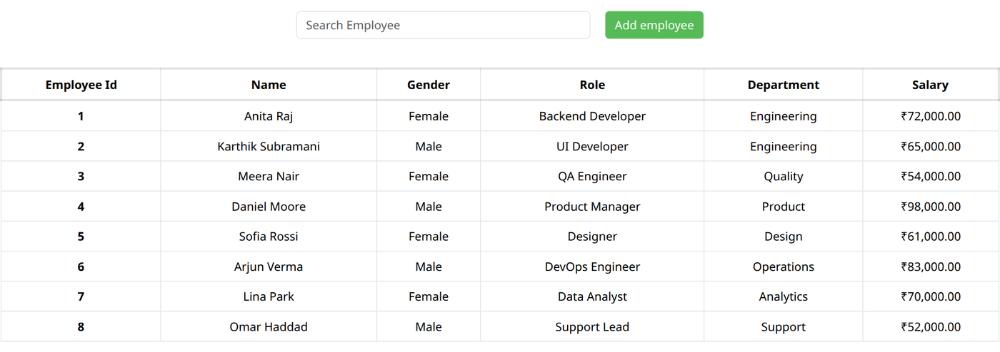
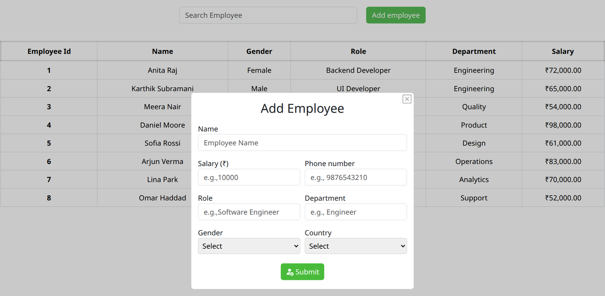

# Employe-management

[](https://github.com/immanoj22/Employe-management/actions/workflows/build.yml)

A simple employee records app. The React front end shows employees in a table and lets you add, edit and delete them. The Spring Boot API stores them in PostgreSQL. I built it as a CRUD practice project.

## What it does
- List all employees in a table
- Add an employee (name, phone number, gender, country, role, department, salary)
- Update an existing employee
- Delete an employee

## Screenshots

The employees below are made-up sample data.

**Employee list**



**Add employee**




## Tech stack
- Backend: Java, Spring Boot, Spring Data JPA, PostgreSQL
- Frontend: React 18, Vite, Axios, CSS

## Layout
- `server/employe-management` - Spring Boot API (port 8080 by default)
- `client/employe-management` - React app, state kept in a context provider

## Running it locally
You need Java, Maven (or `mvnw`), Node and PostgreSQL.

1. Create a local PostgreSQL database and edit `server/employe-management/src/main/resources/application.properties` so the URL, username and password point to it (`your_password`). Use your own database, not the one in the file.
2. The config does not set `ddl-auto`, so create the table yourself. The entity maps to a table called `employer` with columns `employe_id` (serial primary key), `employe_name`, `employe_phonenumber`, `employe_gender`, `employe_country`, `employe_role`, `employe_department` and `employe_salary`. Alternatively add `spring.jpa.hibernate.ddl-auto=update`.
3. Start the API:
   ```
   cd server/employe-management
   ./mvnw spring-boot:run
   ```
4. Start the client:
   ```
   cd client/employe-management
   npm install
   npm run dev
   ```

The client calls `http://localhost:8080` directly.

## API
- `GET /employe` - list employees (`GET /` returns the same)
- `POST /employe` - add an employee
- `PUT /updateemploye` - update an employee
- `DELETE /deleteemploye/{id}` - delete an employee

## Notes
It is plain CRUD. There is no login, validation, search or paging, and no tests beyond the generated one. The API URL is hard-coded in the client. Next I would add validation and move the URL and database settings into environment variables.

Database settings come from `DB_URL`, `DB_USER` and `DB_PASSWORD` in your environment.
